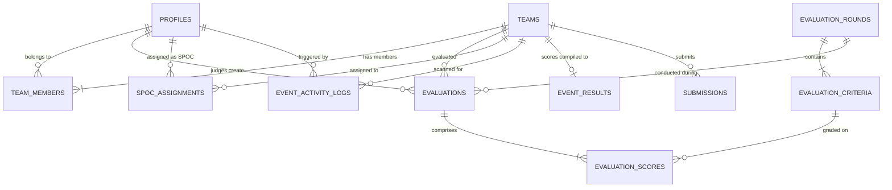

# Supabase Database Architecture & Schema Specification

This document details the relational PostgreSQL database schema, data models, Row Level Security (RLS) policies, and database migration sequences for the IVC-PULSE platform.

---

## 1. Entity Relationship Overview

---

## 2. Core Tables & Descriptions

### `profiles`
Central identity directory linked directly with `auth.users` on `id`.
- `id` (UUID, PK, FK -> `auth.users.id` ON DELETE CASCADE)
- `email` (TEXT, UNIQUE, NOT NULL)
- `full_name` (TEXT)
- `role` (TEXT, ENUM: `'admin'`, `'judge'`, `'staff'`, `'leader'`, `'participant'`)
- `phone` (TEXT)
- `department` (TEXT)
- `avatar_url` (TEXT)
- `created_at` (TIMESTAMPTZ)

### `teams`
Competition participants grouped into teams across specific challenge tracks.
- `id` (UUID, PK)
- `name` (TEXT, NOT NULL)
- `track` (TEXT, NOT NULL) — e.g. *Artificial Intelligence*, *Web3 & FinTech*, *CleanTech*
- `code` (TEXT, UNIQUE, NOT NULL) — Unique check-in identifier / QR payload
- `leader_name` (TEXT)
- `created_at` (TIMESTAMPTZ)

### `team_members`
Association between individual participants (`profiles`) and registered `teams`.
- `id` (UUID, PK)
- `team_id` (UUID, FK -> `teams.id`)
- `user_id` (UUID, FK -> `profiles.id`)
- `role` (TEXT: `'leader'` | `'member'`)
- `name` (TEXT)
- `email` (TEXT)
- `phone` (TEXT)

### `evaluation_rounds`
Milestone competition stages (e.g., Round 1: Ideation Pitch, Round 2: Technical Prototype).
- `id` (UUID, PK)
- `title` (TEXT, NOT NULL)
- `sequence_order` (INT, NOT NULL)
- `status` (TEXT: `'draft'`, `'open'`, `'closed'`, `'completed'`)
- `max_score` (NUMERIC)
- `created_at` (TIMESTAMPTZ)

### `evaluation_criteria`
Specific scoring rubrics tied to each round.
- `id` (UUID, PK)
- `round_id` (UUID, FK -> `evaluation_rounds.id`)
- `title` (TEXT, NOT NULL) — e.g. *Innovation & Novelty*, *Technical Feasibility*, *Market Viability*
- `max_points` (INT, NOT NULL)
- `weight` (NUMERIC, DEFAULT 1.0)

### `evaluations` & `evaluation_scores`
Individual score cards submitted by judges for specific teams during a round.
- `evaluations.id` (UUID, PK)
- `evaluations.round_id` (UUID, FK)
- `evaluations.team_id` (UUID, FK)
- `evaluations.judge_id` (UUID, FK)
- `evaluations.feedback` (TEXT)
- `evaluations.total_score` (NUMERIC)

### `event_results`
Leaderboard and finalized ranks published to participants.
- `id` (UUID, PK)
- `team_id` (UUID, FK, UNIQUE)
- `total_score` (NUMERIC)
- `average_score` (NUMERIC)
- `evaluations_count` (INT)
- `rank` (INT)
- `is_published` (BOOLEAN, DEFAULT false)
- `published_at` (TIMESTAMPTZ)

### `event_activity_logs`
High-speed operational log for QR code scans (attendance, food tokens, kit distribution).
- `id` (UUID, PK)
- `team_id` (UUID, FK)
- `action_type` (TEXT: `'check_in'`, `'kit_collected'`, `'tea_token'`, `'lunch_token'`, `'dinner_token'`)
- `performed_by` (UUID, FK -> `profiles.id`)
- `notes` (TEXT)
- `created_at` (TIMESTAMPTZ)

### `spoc_assignments`
Mapping coordinators (Single Points of Contact) to designated teams for on-site mentoring.
- `id` (UUID, PK)
- `spoc_id` (UUID, FK -> `profiles.id`)
- `team_id` (UUID, FK -> `teams.id`)

### `announcements`
Real-time broadcast alerts streamed across all four portals.
- `id` (UUID, PK)
- `title` (TEXT, NOT NULL)
- `content` (TEXT, NOT NULL)
- `severity` (TEXT: `'info'`, `'warning'`, `'critical'`)
- `target_role` (TEXT: `'all'`, `'team'`, `'judge'`, `'staff'`)
- `is_active` (BOOLEAN, DEFAULT true)

---

## 3. Migration Sequence

Migrations are located in [`supabase/migrations/`](../supabase/migrations/):

1. **`001_initial_schema.sql`**: Core tables for teams, members, criteria, evaluations, and results.
2. **`002_rbac_user_management.sql`**: Role constraints, profile synchronization triggers, and auth hooks.
3. **`003_schema_alignment.sql`**: Schema updates ensuring compatibility with Next.js Server Actions.
4. **`004_spoc_management.sql`**: SPOC coordinator mappings and team allocation logic.
5. **`005_spoc_avatar_support.sql`**: Profile avatar URL support and coordinator WhatsApp contact fields.
6. **`006_realtime_activity_logs.sql`**: Realtime publication enabled for `event_activity_logs` and `announcements`.

---

## 4. Row Level Security (RLS) Summary

All tables have RLS enabled (`ALTER TABLE ... ENABLE ROW LEVEL SECURITY`):
- **Admin**: Has unconditional bypass via `supabaseAdmin` service role client in server actions.
- **Judge**: Read access to assigned teams and active rounds; write access limited to their own submitted evaluations.
- **Team**: Read access limited to their own team profile, submissions, published results, and broadcast announcements.
- **Staff**: Read and write access to `event_activity_logs` and team attendance verification.
